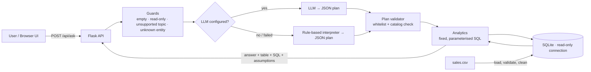

# AI Business Intelligence Assistant

A small web app where a business user asks questions about sales data **in plain English** and gets an answer that is calculated by **real database queries**, together with the supporting numbers and the SQL that produced them.

> "Which region generated the highest sales?" → *South has the highest revenue among regions: ₹4,11,200.00 (28.6% of the ₹14,39,200.00 total)* + a table + the SQL used.

**Stack:** Python 3.10+, Flask, SQLite, pandas, an LLM (Google Gemini or any OpenAI-compatible API) — plus a rule-based fallback that works with **no API key**.

---

## 1. Quick start

```bash
# 1. get the code and enter the folder
cd ai-bi-assistant

# 2. (recommended) create a virtual environment
python -m venv .venv
source .venv/bin/activate          # Windows: .venv\Scripts\activate

# 3. install dependencies
pip install -r requirements.txt

# 4. (optional) enable the LLM — skip this to use the rule-based interpreter
cp .env.example .env               # Windows: copy .env.example .env
#    then edit .env and paste your API key (Gemini or Groq, both have free tiers)

# 5. run
python app.py
```

Open **http://127.0.0.1:5000**. The console prints which LLM provider is active (`none` = rules only).

### Run the tests
```bash
python -m unittest discover -s tests -t . -v      # no extra packages needed
# or
pytest -v
```
Tests never call the network (the LLM is faked), so they are fast and need no API key.

---

## 2. Architecture



| File | Responsibility |
|---|---|
| `bi/database.py` | Load CSV → validate each row → SQLite (`sales`, `rejected_records`); read-only connection |
| `bi/interpreter.py` | Safety guards, LLM-first interpretation, rule-based fallback |
| `bi/llm.py` | Prompt, provider calls (Gemini / OpenAI-compatible), JSON parsing |
| `bi/planner.py` | **Validates every plan** (from the LLM or from rules) before it runs |
| `bi/analytics.py` | The 4 query types + human-readable answers |
| `app.py` | Flask routes and error handling |
| `static/index.html` | Single-page UI |
| `tests/test_app.py` | 32 automated tests |

---

## 3. How the data is stored and queried

* The CSV is loaded into **SQLite** (`data/sales.db`, rebuilt on every start).
* **`sales`** table: one row per valid transaction. Dates are converted from `DD-MM-YYYY` to ISO `YYYY-MM-DD`; a `month` column (`YYYY-MM`) is added; `revenue = quantity × unit_price − discount_amount` is computed once at load time. Constraints (`CHECK quantity > 0`, etc.) are enforced by the database as well.
* **`rejected_records`** table: every row that failed validation, with the CSV line number and the reason. Visible in the UI ("data-quality report") and at `GET /api/data-quality`.
* Queries use **parameterised SQL** (`?` placeholders). Column names are only ever taken from a hard-coded whitelist.
* The web app opens the database **read-only** (`mode=ro`), so INSERT/UPDATE/DELETE/DROP are impossible at the database level.

### Handling of missing / invalid records

| Row | Problem | Decision |
|---|---|---|
| `TXN0034` | Quantity = 0 | **Rejected** (logged with reason) |
| `TXN0051` | Unit_price missing | **Rejected** (logged with reason) |
| `TXN0033` | Status = *Returned* | **Stored**, but **excluded from revenue** (returned goods are not revenue) |
| any | bad date, duplicate ID, negative/oversized discount, non-numeric values | Rejected with reason |
| any | blank Discount_amount | Treated as 0 |

Result for the supplied file: 51 rows → 49 loaded (48 Completed + 1 Returned), 2 rejected.

---

## 4. How the AI is used (and kept honest)

**The LLM is only a question interpreter.** It converts the English question into a small JSON "plan", e.g.
`{"intent": "ranking", "dimension": "region", "order": "desc"}`. It never writes SQL, never sees the data and never calculates numbers.

Why this design instead of text-to-SQL? Free-form LLM SQL can be wrong *without any error* (a plausible but incorrect number), or unsafe. A fixed menu of tested queries is more reliable for business reporting; the trade-off is that only the supported question types can be answered.

**Guardrails against unsupported / incorrect answers**

1. **Pre-LLM guards** — empty/oversized input, destructive words (`delete`, `drop`, `update`…) → HTTP 403, unsupported metrics (profit, forecast, averages, unit counts, "top 3"…) → refused rather than guessed, and entities that are not in the data (e.g. "Smartphone") → refused with the list of valid values.
2. **Plan validation** — intent must be one of 4 whitelisted values; dimension/filter keys are whitelisted; product/region/category/channel values must exist in the database (case-insensitive); months must be `YYYY-MM` **and** have data.
3. **Deterministic execution** — all numbers come from fixed SQL; answers are produced from templates, not by the LLM, so the text can never contradict the table.
4. **Fallback** — if the LLM is down, times out or returns invalid output, the rule-based interpreter answers instead (the UI shows which one was used).
5. **Transparency** — every answer shows "Understood as …", the supporting table, the exact SQL + parameters, and the assumptions.
6. **Defence in depth** — read-only DB connection; LLM output is treated as untrusted input; the user's question is treated as data in the prompt.

---

## 5. Supported questions

| Type | Examples |
|---|---|
| Total revenue | "What is the total revenue?" · "Total revenue for the North region" · "Total revenue in May" |
| Ranking | "Which product generated the highest revenue?" · "Which region generated the highest sales?" · "Lowest revenue category" · "Revenue by channel" |
| Monthly trend | "Show the monthly revenue trend" · "Monthly revenue for Monitor" |
| Month comparison | "How did revenue change between January and February?" · "How did revenue change in March?" (vs. previous month) |

All five example questions from the brief are supported, plus optional filters (product / region / category / channel / month).

## 6. API

`POST /api/ask` with `{"question": "..."}`

```jsonc
{
  "status": "ok",
  "answer": "Monitor has the highest revenue among products: ₹4,73,000.00 (32.9% of the ₹14,39,200.00 total).",
  "interpretation": {"intent": "ranking", "dimension": "product", "order": "desc", "filters": {}, "months": [], "interpreted_by": "llm|rules|rules_fallback", "notes": []},
  "supporting_data": {"columns": ["product", "revenue", "units_sold", "orders", "share_pct"], "rows": [["Monitor", 473000.0, 50, 9, 32.9]], "formats": {}},
  "sql": "SELECT product AS product, SUM(revenue) ...", "sql_params": ["..."],
  "assumptions": ["Revenue = Quantity × Unit_price − Discount_amount.", "..."]
}
```
Errors: `{"status": "error", "error": {"code": "...", "message": "...", "suggestions": [...]}}` with HTTP `400` (bad input), `403` (read-only violation), `422` (unsupported / no data), `500` (unexpected; details are logged, never sent to the client).

Other endpoints: `GET /api/health`, `GET /api/data-quality`.

---

## 7. Tests (32)

* **Correctness** — expected values are computed *independently with pandas* and compared with the API's SQLite results (total, top product/region, monthly trend, month comparison, filters).
* **Invalid input** — empty question, non-JSON body, unrelated question, unsupported metric, destructive request (also asserts the data is unchanged), unknown route.
* **Edge cases** — month with no data, unknown product, "from Jan to March" ambiguity, top-N, duplicates / impossible dates / oversized discount in a custom CSV.
* **Data management** — rejected rows and reasons, Returned order excluded, DB connection is truly read-only.
* **AI layer (faked LLM)** — valid plan used; malicious plan (`DROP TABLE`) rejected → fallback; LLM failure → fallback; hallucinated product rejected; destructive question never reaches the LLM; provider response parsing.

---

## 8. Known limitations

* Only the question types in section 5 are supported; anything else is refused (by design).
* Rule-based fallback is keyword-based: unusual phrasing may be refused, and a standalone word like "may" is read as the month.
* Month ranges / multi-month sums, top-N lists, units/order counts, averages and forecasts are not supported.
* "Sales" is interpreted as net revenue (not units). Currency is assumed to be INR (the CSV has none).
* Single-year, small dataset: the database is rebuilt from the CSV at start-up; no incremental loads or authentication.
* The live LLM call depends on third-party model names that change over time — set `LLM_MODEL` in `.env` if the default is retired.

## 9. What I would improve with another day

* Add metric support (units, order count, average order value) and top-N / date-range queries.
* Conversation memory for follow-ups ("and for the South region?").
* A small evaluation set to measure LLM-vs-expected plan accuracy and compare models.
* Add charts to the UI (trend line / ranking bar chart).
* Dockerfile + GitHub Actions CI to run tests on each push.
* Optional text-to-SQL mode with an AST-level validator (single `SELECT`, table/column allow-list) behind a feature flag.
